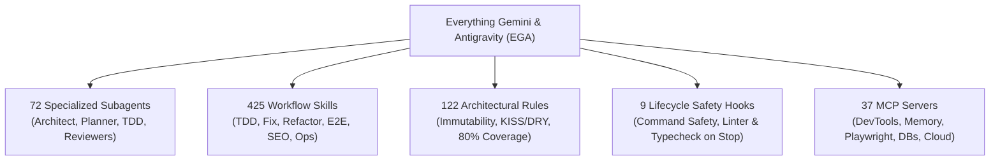
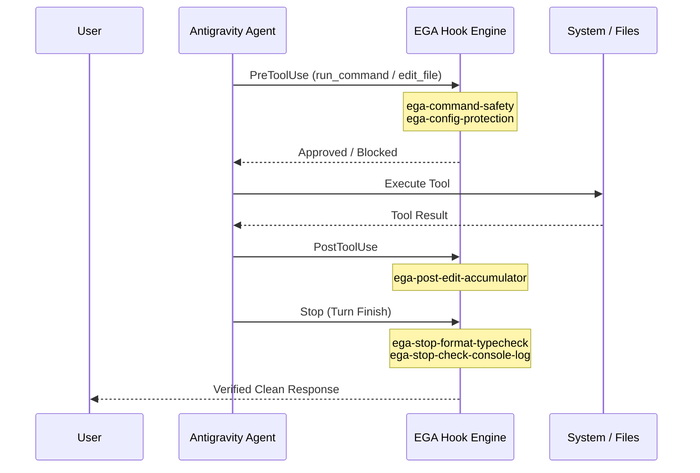

# Everything Gemini and Antigravity (EGA)

<div align="center">


### The Complete Autonomous Engineering System for Google Gemini & Antigravity

[](https://antigravity.google)
[](./plugin.json)
[](./LICENSE)
[](./agents)
[](./skills)
[](./rules)
[](./mcp_config.json)

<br/>

**Transform Antigravity from an AI coding assistant into an elite, autonomous software engineering organization.**  
Bringing 72 specialized subagents, 425 battle-tested workflow skills, 122 architectural rules, 37 pre-wired MCP servers, and native lifecycle safety hooks together into a unified, one-click installable plugin.

[Quick Install](#-quick-install) • [Ported from ECC](#-origin--evolution-the-antigravity-port-of-ecc) • [Core Pillars](#-the-5-core-pillars-of-ega) • [Subagents](#1-specialized-subagents-72-agents) • [MCP Catalog](#3-mcp-servers-catalog-37-servers) • [Credits & Attribution](#-credits-acknowledgements--upstream-lineage)

</div>

---

## 🚀 Origin & Evolution: The Antigravity Port of ECC

> **EGA is the official, ready-made Google Gemini & Antigravity port of [Everything Claude Code (ECC)](https://github.com/affaan-m/ECC).**

**Everything Claude Code (ECC)**, originally created by [Affaan Mustafa](https://github.com/affaan-m), established the gold standard for agentic engineering workflows, autonomous subagents, and deterministic safety hooks for Claude Code.

**EGA (Everything Gemini and Antigravity)** brings that entire battle-tested ecosystem natively into **Google Gemini and the Antigravity harness**. Rather than running an emulation layer, EGA has been re-architected from the ground up for Antigravity's next-generation architecture:

- 🔄 **Native Subagent Schemas**: All 72 subagents conform to Antigravity's native `subagent: true` schema and bind directly to Antigravity core primitives (`read_file`, `edit_file`, `write_file`, `run_command`, `manage_task`, `search_web`).
- ⚡ **First-Class Skill Migration**: All 98 original ECC slash commands have been transformed into native, discoverable Antigravity skills alongside the 327 specialized engineering workflows (425 total).
- 🛡️ **Native ProtoJSON Hook Bridge**: Custom lifecycle adapter bridging Antigravity's protojson event pipeline (`PreToolUse`, `PostToolUse`, `Stop`) with zero process latency.
- 🔌 **Unified MCP Orchestration**: 37 pre-wired MCP servers configured for Antigravity's tool discovery engine, featuring 8 zero-config active servers and 29 on-demand services with crash-proof defaults.
- 🧠 **Gemini Multi-Model Routing**: Tuned for Gemini's long-context capabilities, adaptive reasoning, and cost-effective tier routing (Haiku / Sonnet / Opus equivalents).

### ❓ Why Can't I Just Drop Upstream ECC into Antigravity?

Upstream ECC was engineered specifically around Claude Code's shell/regex event harness. When dropped into Google Antigravity:
1. **Silent Hook Failures**: Antigravity uses a ProtoJSON event lifecycle (`PreToolUse`, `PostToolUse`, `Stop`). Standard Claude hook scripts fail silently, meaning **zero safety gates, zero auto-formatting, and zero command protection**.
2. **The Legacy Hack (File Injection)**: Other downstream attempts (like `cloudblower/ECC-Antigravity`) attempted to bridge this by copying hundreds of loose files into a `.agents/` folder inside your project and running nested Node subprocess wrappers. This causes **severe git repository pollution, inflated commit diffs, and slow execution latency**.
3. **The EGA Solution (Native Plugin)**: EGA solves this properly by packaging as a **first-class Antigravity plugin** (`plugin.json` v2.3.0). It installs globally with one command, executes hooks in-process via a native ProtoJSON bridge, and leaves your project repositories **100% clean**.

---

## 📊 Architectural Comparison: Why Developers Choose EGA

| Evaluation Dimension | Vanilla Antigravity | Legacy File Injection (`cloudblower`) | Everything Gemini & Antigravity (EGA) |
| :--- | :---: | :---: | :---: |
| **Packaging & Distribution** | Standard Harness | Git clone + local shell script | **Native Antigravity Plugin (`plugin.json` v2.3.0)** |
| **Installation Scope** | Default | Per-project (`.agents/` folder) | **Global (`agy plugin install`) or Local** |
| **Workspace Pollution** | Clean | **Severe**: Dumps 300+ files into your repo | **Zero**: Project working trees remain 100% clean |
| **Hook Latency** | None | **High**: Nested Node subprocesses on every tool | **Zero-Lag**: Direct in-process ProtoJSON execution |
| **Tool Coverage** | Native Tools | Missing `write_file`, `edit_file`, `read_file` | **Complete**: Native coverage of all Antigravity primitives |
| **Specialized Subagents** | Basic agents | 68 adapted agents | **72 specialized subagents** |
| **Workflow Skills** | Standard | ~293 skills | **425 skills** (including 98 converted slash commands) |
| **Pre-Wired MCP Servers** | 0 | 0 (Manual configuration) | **37 servers** (8 active zero-config, 29 on-demand) |
| **Marketplace Ready** | Yes | No (Incompatible with plugin engine) | **100% Compliant** with Plugin Validator |

---

## ⚡ Quick Install

Choose your preferred installation method:

### Option 1: Native Antigravity Plugin CLI (Recommended)
Install globally across all workspaces in one command:
```bash
agy plugin install https://github.com/gamiheme/ega
```

### Option 2: Windows 1-Click Bootstrap (PowerShell)
```powershell
irm https://raw.githubusercontent.com/gamiheme/ega/main/install.ps1 | iex
```

### Option 3: Linux / macOS 1-Click Bootstrap (Bash)
```bash
curl -fsSL https://raw.githubusercontent.com/gamiheme/ega/main/install.sh | bash
```

*Or install locally from a cloned repository or release zip:*
```bash
agy plugin install ./ega
```

Verify your installation:
```bash
agy plugin list
```

You should see:
```text
✔ ega (enabled, 2.3.0) - Everything Gemini and Antigravity
  skills: 425 · agents: 72 · rules: 122 · hooks: 9 · mcpServers: 37
```

**EGA is immediately active across all workspaces, sessions, and agents!**

---

## 💎 Why EGA?

| Without EGA | With EGA |
| :--- | :--- |
| Single agent trying to do planning, coding, and review all in one prompt. | **72 specialized subagents** autonomously delegated based on exact task domain. |
| Ad-hoc, unstructured code changes prone to regressions. | **Rigorous TDD loops** enforcing RED-GREEN-REFACTOR with 80%+ test coverage. |
| Risky shell operations (`rm -rf`, `--no-verify`, config overwrites). | **Active lifecycle hooks** blocking dangerous commands and protecting project configs. |
| Manual setup of documentation, API connectors, and linters. | **425 instant workflow skills** covering full-stack dev, E2E tests, cloud, and security. |
| Zero or cumbersome MCP server configurations. | **37 pre-wired MCP servers** with 8 zero-config servers ready out of the box. |

---

## 🏛️ The 5 Core Pillars of EGA



---

### 1. Specialized Subagents (72 Agents)

EGA gives Antigravity the ability to delegate specialized tasks to domain experts, keeping your primary agent focused on orchestration:

#### 🎯 Core Orchestration & Strategy
- `architect`: High-level system design, scalability planning, and architectural blueprints.
- `planner`: Implementation planning, dependency mapping, and risk mitigation phases.
- `tdd-guide`: Test-Driven Development leader enforcing write-tests-first methodology.
- `code-reviewer`: Thorough code quality, idiomatic pattern, and maintainability reviewer.
- `security-reviewer`: Vulnerability scanner (OWASP Top 10, secrets, injection, auth flows).
- `build-error-resolver`: Surgical compiler, linter, and type error fixer.

#### 🌐 Full-Stack & Language Specialists
- **TypeScript / JavaScript**: `typescript-reviewer`, `react-reviewer`, `vue-reviewer`, `react-build-resolver`
- **Python**: `python-reviewer`, `fastapi-reviewer`, `django-reviewer`, `django-build-resolver`
- **Systems & Modern Languages**: `rust-reviewer`, `rust-build-resolver`, `go-reviewer`, `go-build-resolver`, `cpp-reviewer`, `cpp-build-resolver`
- **Mobile & Cross-Platform**: `flutter-reviewer`, `dart-build-resolver`, `swift-reviewer`, `swift-build-resolver`, `kotlin-reviewer`, `kotlin-build-resolver`, `harmonyos-app-resolver`
- **Enterprise & JVM**: `java-reviewer`, `java-build-resolver`, `csharp-reviewer`, `php-reviewer`

#### 🔬 Specialized Engineering & Quality
- `database-reviewer`: PostgreSQL, Supabase, and SQL query indexing and optimization.
- `e2e-runner`: End-to-end browser journey tester using Playwright.
- `performance-optimizer`: Profiling, memory leak diagnosis, and bundle-size reduction.
- `silent-failure-hunter`: Catches swallowed errors, unhandled rejections, and brittle fallbacks.
- `mle-reviewer` & `rag-pipeline-reviewer`: Production ML and RAG pipeline evaluation.
- `healthcare-reviewer`: Clinical safety, CDSS validation, and HIPAA/PHI compliance.

---

### 2. Workflow Skills & Converted Commands (425 Skills)

EGA turns complex developer workflows into repeatable, single-invocation skills:

- **Autonomous Orchestration Cycles**:
  - `/orch-add-feature`: Complete lifecycle of adding a new feature (Plan → TDD → Review → Commit).
  - `/orch-fix-defect`: Reproduce bugs as failing regression tests, fix to green, review, and commit.
  - `/orch-refine-code`: Behavior-preserving refactor with green-test guarantees.
- **Developer Accelerators**:
  - `/build-fix`: Incremental, surgical resolution of build and type errors.
  - `/checkpoint`: Create and verify workflow savepoints with full state tracking.
  - `/aside`: Ask context-free side questions without interrupting your main agent task.
  - `/crosspost`: Multi-platform content distribution across social channels.
  - `/codehealth-mcp`: Structural code health scoring via CodeScene MCP.
- **Domain Engineering Skills**:
  - Backend, frontend, microservices, database migrations, Docker, Kubernetes, and serverless architectures.
  - Deep-research, competitive intelligence, documentation synchronizers, and i18n translation pipelines.

---

### 3. Native Lifecycle Safety Hooks

EGA features a non-intrusive safety net implemented via native Antigravity lifecycle hooks:



- 🛑 **`ega-command-safety` (`PreToolUse`)**: Blocks destructive shell commands (`rm -rf /`, `--no-verify`, unauthorized git pushes, database drop commands).
- 🔒 **`ega-config-protection` (`PreToolUse`)**: Prevents agents from silently disabling linters or loosening compiler strictness in `.eslintrc`, `tsconfig.json`, or `biome.json`.
- 📁 **`ega-doc-file-warning` (`PreToolUse`)**: Prevents documentation sprawl across root project directories.
- 📦 **`ega-post-edit-accumulator` (`PostToolUse`)**: Collects all files modified during a session for automated batch verification.
- 🧹 **`ega-stop-format-typecheck` (`Stop`)**: Automatically triggers formatters (Biome/Prettier) and type checks (`tsc`) before completing the task.
- 🔍 **`ega-stop-check-console-log` (`Stop`)**: Audits touched files for stray `console.log` statements.

#### Hook Strictness Profiles
Easily toggle hook intensity in your environment:

```bash
# Minimal: Core command safety only
export EGA_HOOK_PROFILE=minimal

# Standard (Default): Safety, warnings, batch formatting & typecheck on stop
export EGA_HOOK_PROFILE=standard

# Strict: Adds confirmation gates on security-sensitive modules
export EGA_HOOK_PROFILE=strict

# Master kill-switch (if you need raw bypass)
export EGA_HOOKS_ENABLED=false
```

---

### 4. MCP Servers Catalog (37 Servers)

EGA bundles complete connectivity for the modern developer stack:

#### 🟢 Active Out-of-the-Box (Zero-Config)
Ready to use immediately with zero setup or API keys:
1. **`chrome-devtools`**: Web automation, CSS inspection, and console/network debugging.
2. **`sequential-thinking`**: Step-by-step hypothesis testing and complex problem decomposition.
3. **`memory`**: Persistent knowledge graph preserving user preferences and project discoveries.
4. **`token-optimizer`**: Context deduplication, prompt caching, and token compression.
5. **`magic`**: Magic UI component generator and UI registry browser.
6. **`playwright`**: Headless browser automation for live page testing.
7. **`cloudflare-docs`**: Instant search of Cloudflare official documentation and recipes.
8. **`laraplugins`**: Laravel package discovery and ecosystem evaluation.

#### 🟡 Pre-Wired On-Demand Services (29 Servers)
Configured with `"disabled": true` so your startup is fast and error-free. Turn on any server by setting its API key in `.env` (see [`.env.example`](./.env.example)) and enabling it in [`mcp_config.json`](./mcp_config.json):

- **Developer Tools**: `github`, `jira`, `confluence`, `codescene`, `filesystem`
- **Web & Neural Search**: `firecrawl`, `exa-web-search`, `browserbase`, `browser-use`, `parallel-search`, `arcmira`
- **Databases & Cloud**: `supabase`, `clickhouse`, `railway`, `vercel`, `cloudflare-workers-builds`, `cloudflare-workers-bindings`, `cloudflare-observability`
- **AI & Memory Systems**: `fal-ai`, `memxus`, `omega-memory`, `deja-vu`, `longhand`, `nexus`, `ito-compute`, `devfleet`, `evalview`, `mnemosyne-os`, `ega-memory-vault`

---

### 5. Architectural Rules & Guardrails (122 Rules)

EGA enforces deterministic software engineering principles across your codebase:

- **Immutability First**: Always produce new state objects; never mutate in-place.
- **KISS, DRY & YAGNI**: No speculative abstractions before the second caller.
- **Test-Driven Discipline**: 80%+ mandatory test coverage on all new functionality.
- **Micro-Modular File Sizing**: High-cohesion files (200-400 lines typical, 800-line soft ceiling).
- **OWASP Top 10 Security**: Input validation at all system boundaries, parameterized queries, and strict secret hygiene.

---

## 🛠️ Verification & Quality Assurance

EGA is verified using the official Antigravity plugin validator:

```bash
agy plugin validate ./
```

Output:
```text
Validating ega (plugin.json)
  skills 425 · agents 72 · rules 122 · hooks 9 · mcpServers 37 · sidecars 0
✔ Validation passed with 0 errors
```

---

## 🤝 Credits, Acknowledgements & Upstream Lineage

EGA stands on the shoulders of giants. We express our deepest gratitude and credit to:

- **[Affaan Mustafa](https://github.com/affaan-m)** — Original author and creator of [Everything Claude Code (ECC)](https://github.com/affaan-m/ECC). Affaan's vision, architecture, and pioneering agentic workflows provided the foundation upon which EGA was built.
- **The ECC Community & Contributors** — Whose community skills, rules, and scripts established the gold standard for AI-assisted software engineering.
- **Google DeepMind & The Antigravity Team** — For creating Antigravity, the world-class harness and agent runtime that makes autonomous subagent orchestration possible.
- **The Model Context Protocol (MCP) Community** — For creating the open standards and MCP servers that power EGA's seamless integrations.

---

## 📄 License

Everything Gemini and Antigravity (EGA) is licensed under the **[MIT License](./LICENSE)**.

```text
Copyright (c) 2026 Affaan Mustafa
Copyright (c) 2026 Everything Gemini and Antigravity (EGA) Contributors
```

You are free to use, modify, distribute, and integrate EGA in personal, commercial, and enterprise workflows.
